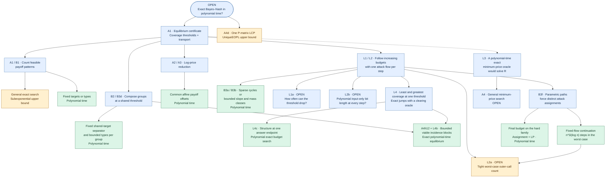

# Bayesian security games proof map

[Investigation tree](TREE.md)

🟦 Proof step or open route · 🟩 Complexity settled for the stated case · 🟨 Bound on a case that remains open

## Exact Bayes–Nash equilibrium

[L1a · Threshold drops](investigation/L1a.md) · [L2a · Tight trajectory length](investigation/L2a.md) · [L2b · Intermediate arithmetic](investigation/L2b.md)

[Threshold and transport certificate](notes/A1-threshold-transport.md) · [Pattern count](notes/B1-classify-run-lengths.md) · [Exact continuation upper bound](notes/L2-exact-arithmetic-audit.md)

[Component composition](notes/B2-component-composition.md) · [Shared-target solver](notes/B3d-shared-target-separator.md) · [Common-offset solver](notes/A3-mixed-offsets.md)

[Sparse cycles](notes/B3a-fixed-flow-jump.md) · [Bounded slope and mass classes](notes/B3b-closed-group-rank.md) · [Forced-flow lower bound](notes/B3f-forced-flow-switches.md)

[Direct P-matrix reduction for the Bayesian game](notes/A4d-p-matrix-complementarity.md) · [Newton bounds and exact threshold jumps](notes/L4-newton-and-continuation.md)

[Structure at one budget endpoint](notes/L4-structured-endpoints.md) · [Mixed articulations via buyer proxies](notes/A4h-buyer-proxy.md)

## A4 minimum-price market branch

A4c replaces the minimum-price oracle in L3 with an oracle for any clearing equilibrium. A4d reduces either market search problem to one P-matrix LCP. [L3 oracle reduction](notes/L3-prior-partials.md#conditional-exact-reduction-to-a-minimum-price-oracle) · [A4c supply perturbation](notes/A4c-any-clearing-equilibrium.md) · [A4d complementarity reduction](notes/A4d-p-matrix-complementarity.md)

```mermaid
flowchart TB
    AS(["OPEN<br/>Find exact minimum prices in polynomial time"])
    AS --> V["Given candidate prices<br/>Binary-encoded fractional masses and capacities<br/>Strictly decreasing affine utilities"]
    V --> VC["Candidate verification is polynomial<br/>One rational flow test + reverse graph search"]

    AS --> C["A4c · Enlarge supplies by a small rational amount<br/>Any clearing equilibrium returns minimum prices"]
    C --> CL["Exact search in CLS<br/>Piecewise-linear fixed point + local search"]
    C --> PL["A4d · One P-matrix LCP<br/>UniqueEOPL upper bound"]
    PL --> NH["L4 · Newton solve-count guarantee<br/>Exponential handicap after regularization"]
    PL --> AF["A4f · Smaller node formulation<br/>Global polynomial handicap open"]
    PL --> AL["A4g · All-ones Lemke path<br/>n^Ω(log n) affine pieces"]
    AS --> AG["A4g · Exact search on candidate price lists"]
    AG --> AC["Logarithmic incidence cycle rank<br/>Exact polynomial-time solver"]
    AG --> AH["A4h · Generate complete price lists or regions"]
    AH --> AB["Bounded-size blocks · at most two articulation goods<br/>or bounded buyers and goods per block<br/>Complete polynomial lists"]
    AH --> AO["Small aggregate slope corrections or approximate common offsets<br/>Exact polynomial-time solvers"]
    AH --> AQ["General markets<br/>Polynomial number of region queries"]
    AH --> AX["Complete boundary tables and load hulls<br/>Exponential size"]
    AX --> AT["A4h4 · Count price plateaus or load drops<br/>NP-hard even with unit slopes"]
    AH --> AJ["A4h5 · Use supplied capacities"]
    AJ --> ASB["Clip branch loads on bounded-size blocks<br/>Polynomial with bounded usable quantity range"]
    AJ --> ASC["Query loads on a near-factorized core<br/>Exact polynomial solver with conditional branch solvers"]
    AJ --> AJT["A4h6 · Safe alternating price jumps<br/>Finite ascent · superpolynomial general path count"]
    AJ --> AJR["A4h7 · Certified tied price groups<br/>Exact polynomial recovery on group forests"]
    AJ --> AJD["A4h8 · Fixed boundary quotes<br/>One conditional price vector preserves every completion"]
    AJT --> AHY["A4h9 · Test and contract ties found during ascent<br/>Exact sign via one smaller grouped solve"]
    AJR --> AHY
    AJD --> AHM["A4h9 · Tractable branches at single buyers or goods<br/>Polynomial exact solving on a factorized core"]
    AHY -.-> AHM
    AHY --> AJG["A4h10 · Certified synchronized quotes<br/>Exact search using signed branch loads"]
    AJD --> AJG
    AHM --> AJC["A4h11 · Common-offset core<br/>Exact polynomial solver with mixed branches"]
    AB --> AJP["A4h12 · Buyer-to-good proxy<br/>Exact polynomial solver on bounded incidence blocks"]
    AS --> F["A4a · Near-factorized slopes<br/>Exact polynomial-time solver"]
    AS --> G["A4b · Interaction graphs of bounded elimination depth<br/>or forests after a fixed number of deletions<br/>Exact polynomial-time solvers"]
    AS --> CV["A4e · Covering LP and unweighted flow"]
    CV --> CD["Reweighted cover with slope tie-break<br/>Exact search · exponential iteration bound"]
    CV --> CO["Common intercept offsets with arbitrary slopes<br/>Exact polynomial-time solver"]
    CO --> AJC

    B["B3f · Forced attack assignments"] --> M["A4 · Hard market<br/>n goods · two units each · 2n+1 unit buyers<br/>Zero reserves · affine utilities"]
    AS -.-> M
    M -.-> F
    M --> D["September · No underdemand<br/>at good prices"]
    M --> P["October §5.1 · Project to each good’s<br/>maximum transaction price"]
    P --> T["No underdemand on<br/>maximum-price trades"]
    D --> H["Hall’s condition transfers<br/>the B3f assignment sequence"]
    T --> H
    H --> S["Oki–Sato September directional auction<br/>n^Ω(log n) worst-case iterations"]
    H --> O["Oki–Sato October trading-network algorithm<br/>§5.1 single-seller reduction<br/>n^Ω(log n) worst-case iterations"]

    classDef proof fill:#e4efff,stroke:#4275ad,color:#142f4e
    classDef settled fill:#dcf5e7,stroke:#38805c,color:#143e2a
    classDef cap fill:#fff0cf,stroke:#a86c18,color:#502e07

    class AS,V,C,AF,AG,AH,AJ,CV,B,M,D,P,T,H proof
    class VC,F,G,CO,AC,AB,AO,AX,AT,ASB,ASC,AJR,AJD,AHM,AJG,AJC,AJP,AL,S,O settled
    class CL,PL,NH,CD,AQ,AJT,AHY cap
```

[Minimum-price certificate](notes/A4-minimum-price-markets.md#certifying-a-candidate-minimum-price) · [Near-factorized solver](notes/A4a-near-factorized-slopes.md) · [Hall search and good elimination](notes/A4b-direct-hall-search.md) · [Covering LPs](notes/A4e-covering-lp.md) · [Bounded-handicap formulation](notes/A4f-handicap-formulation.md)

[B3f assignment-forcing proof](notes/B3f-forced-flow-switches.md#why-every-equilibrium-uses-the-prescribed-assignment) · [A4 market construction and iteration bounds](notes/A4-minimum-price-markets.md#lower-bound-for-the-directional-ascending-auctions)

[Bounded support search and Lemke lower bound](notes/A4g-budgeted-support-search.md) · [Complete candidate generation](notes/A4h-complete-candidate-generation.md) · [Table count hardness](notes/A4h-table-count-hardness.md) · [Candidates at the supplied capacity](notes/A4h-supplied-capacity.md)

[Alternating price jumps](notes/A4h-alternating-tree.md) · [Forced price relations](notes/A4h-forced-price-relations.md) · [Boundary dominance](notes/A4h-boundary-dominance.md) · [Grouped comparisons](notes/A4h-hybrid-jumps.md) · [Composition at shared buyers and goods](notes/A4h-mixed-port-composition.md)

[Synchronized shared quotes](notes/A4h-synchronized-ports.md) · [Offset cores and weak-game repairs](notes/A4h-core-composition-closures.md) · [Buyer proxies and mixed block trees](notes/A4h-buyer-proxy.md)
