<!-- Generated from catalog/ and records/ by scripts/build_map.rb -->

# Investigation tree

Blue shows open questions, amber shows partial bounds, and green shows results for the stated scope. [Browse the linked questions](README.md)

```mermaid
flowchart TD
  n0["R"]:::partial
  n1["L"]:::background
  n0 --> n1
  n2["L1"]:::scoped
  n1 --> n2
  n3["L1a"]:::scoped
  n2 --> n3
  n4["L2"]:::scoped
  n1 --> n4
  n5["L2a"]:::open
  n4 --> n5
  n6["L2b"]:::open
  n4 --> n6
  n7["L3"]:::background
  n1 --> n7
  n8["L4"]:::partial
  n1 --> n8
  n9["L4a"]:::scoped
  n8 --> n9
  n10["L4b"]:::scoped
  n8 --> n10
  n11["B"]:::background
  n0 --> n11
  n12["B1"]:::scoped
  n11 --> n12
  n13["B2"]:::scoped
  n11 --> n13
  n14["B3"]:::partial
  n11 --> n14
  n15["B3a"]:::scoped
  n14 --> n15
  n16["B3b"]:::scoped
  n14 --> n16
  n17["B3c"]:::scoped
  n14 --> n17
  n18["B3d"]:::partial
  n14 --> n18
  n19["B3e"]:::scoped
  n14 --> n19
  n20["B3f"]:::scoped
  n14 --> n20
  n21["B3g"]:::scoped
  n14 --> n21
  n22["A"]:::background
  n0 --> n22
  n23["A1"]:::scoped
  n22 --> n23
  n24["A2"]:::scoped
  n22 --> n24
  n25["A3"]:::scoped
  n22 --> n25
  n26["A4"]:::scoped
  n22 --> n26
  n27["A4a"]:::scoped
  n26 --> n27
  n28["A4b"]:::scoped
  n26 --> n28
  n29["A4c"]:::scoped
  n26 --> n29
  n30["A4d"]:::scoped
  n26 --> n30
  n31["A4e"]:::open
  n26 --> n31
  n32["A4e1"]:::scoped
  n31 --> n32
  n33["A4e2"]:::scoped
  n31 --> n33
  n34["A4e3"]:::scoped
  n31 --> n34
  n35["A4f"]:::open
  n26 --> n35
  n36["A4f1"]:::scoped
  n35 --> n36
  n37["A4f2"]:::partial
  n35 --> n37
  n38["A4g"]:::partial
  n26 --> n38
  n39["A4g1"]:::scoped
  n38 --> n39
  n40["A4g2"]:::scoped
  n38 --> n40
  n41["A4g3"]:::partial
  n38 --> n41
  n42["A4h"]:::open
  n26 --> n42
  n43["A4h1"]:::scoped
  n42 --> n43
  n44["A4h2"]:::scoped
  n42 --> n44
  n45["A4h3"]:::partial
  n42 --> n45
  n46["A4h4"]:::scoped
  n42 --> n46
  n47["A4h5"]:::scoped
  n42 --> n47
  n48["A4h6"]:::partial
  n42 --> n48
  n49["A4h7"]:::partial
  n42 --> n49
  n50["A4h8"]:::partial
  n42 --> n50
  n51["A4h9"]:::partial
  n42 --> n51
  n52["A4i"]:::scoped
  n26 --> n52
  n53["A4i1"]:::open
  n52 --> n53
  n54["H"]:::background
  n0 --> n54
  n55["H1"]:::open
  n54 --> n55
  n56["H2"]:::open
  n54 --> n56
  n57["L4c"]:::scoped
  n8 --> n57
  n58["A4h10"]:::scoped
  n42 --> n58
  n59["A4h11"]:::scoped
  n42 --> n59
  n60["A4h12"]:::scoped
  n42 --> n60
  n61["A4f3"]:::scoped
  n35 --> n61
  n62["A4i1a"]:::scoped
  n53 --> n62
  n63["A4i1b"]:::scoped
  n53 --> n63
  n64["A4i1c"]:::scoped
  n53 --> n64
  n65["A4i1d"]:::scoped
  n53 --> n65
  n66["A4l"]:::scoped
  n26 --> n66
  n67["A4m"]:::partial
  n26 --> n67
  n68["2cda0f31-ecad-4bb0-b12e-b040dafa66cd"]:::open
  n26 --> n68
  n69["3244b26a-6160-43e2-9b81-1650d78dd4cb"]:::open
  n54 --> n69
  classDef open fill:#deebff,color:#142f4e,stroke:#4275ad
  classDef partial fill:#fff0cf,color:#502e07,stroke:#a86c18
  classDef scoped fill:#dcf5e7,color:#143e2a,stroke:#38805c
  classDef background fill:#eee,color:#222,stroke:#777
```

